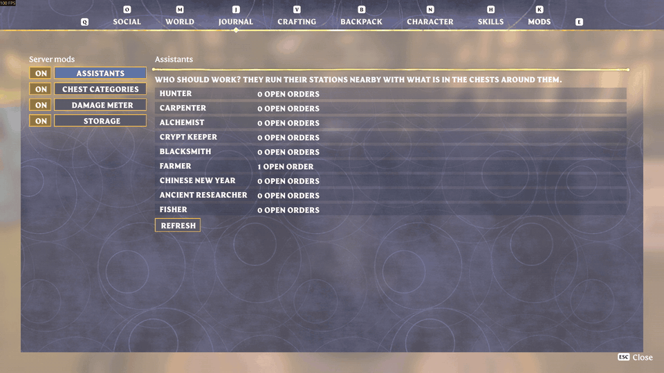
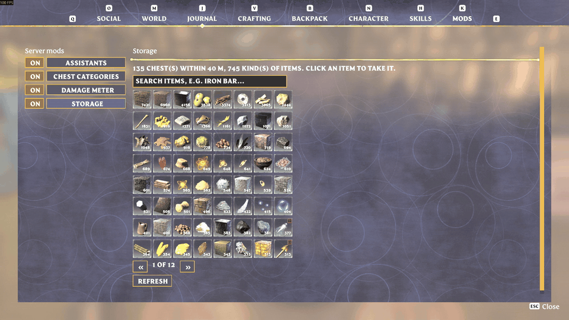
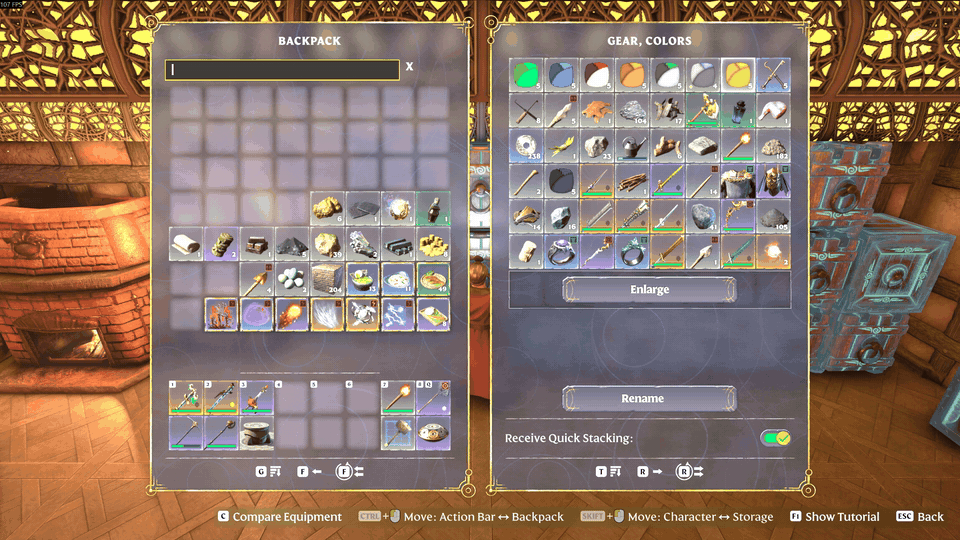
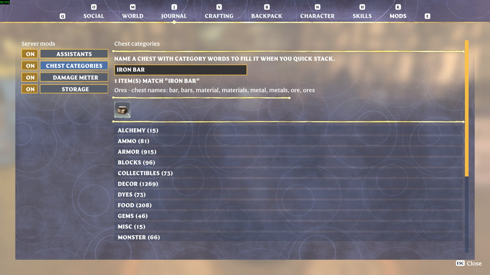
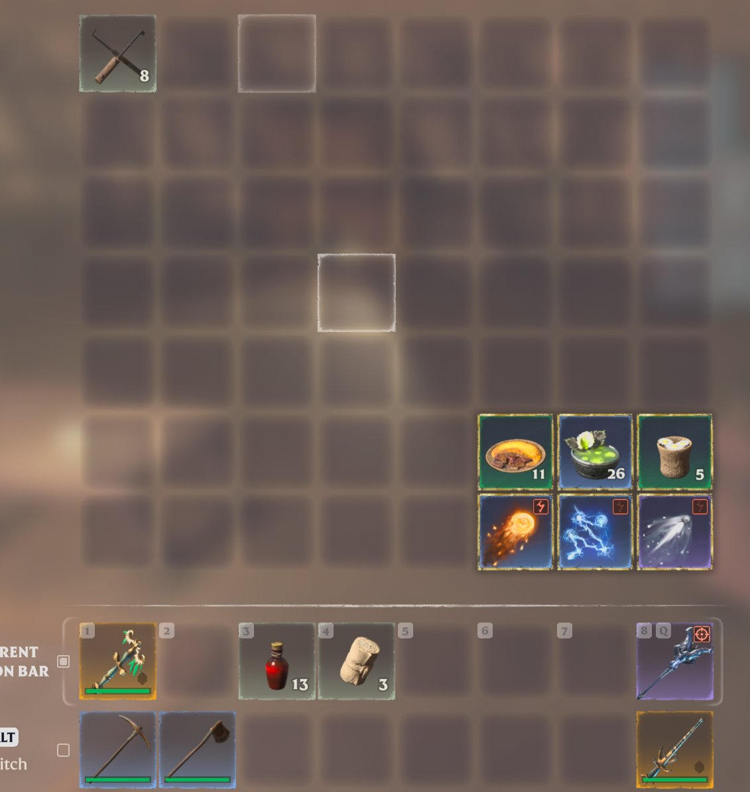

# shroudlink

> [!CAUTION]
> **Bigger stacks (x10) or bigger chests (x2) on your server? Back up your saves before every game update.**
>
> A game update brings back the game's normal data files. If the server loads your world
> before the patched files are back, the game **deletes everything above the normal stack
> size and everything in the extra chest slots**. Characters that join such a server can lose
> the same from their backpack. Without a backup it is gone for good.
>
> - **Server owners:** keep the host's auto update off. Stop the server, copy its
>   `savegame` folder somewhere safe, then update with `UPDATE-SERVER.bat`, which does it
>   in the safe order ([Game updates](docs/wiki/Server-Game-Updates.md)). Start the server
>   only after the patched files are uploaded.
> - **Players:** before you join after an update, copy your characters
>   (`Steam\userdata\<your id>\1203620\remote\`) somewhere safe, and join only once the
>   server owner says the server is patched.

**Server mods for Enshrouded 1.0 dedicated servers, with their own MODS tab in the game.**
Rename a chest "Food, Wood" and hold R: everything of those kinds goes in. Tell a
survivor "make 5 Iron Bars" and they run the furnace with what is in your chests.
Players without the addon join and play normally.



**[Download the latest release](https://github.com/bjck/shroudlink/releases/latest)** ·
**[On Nexus Mods](https://www.nexusmods.com/enshrouded/mods/278)** ·
[Install for players](docs/wiki/Players-Installing-the-Addon.md) (1 minute) ·
[Install on a server](docs/wiki/Server-Installation.md) ·
[Write your own mod](docs/wiki/Modding-Getting-Started.md)

## What you get

| Mod | What it does | Needs the addon |
|---|---|---|
| **chestsort** | Chests sort by name: rename a chest to categories (`Food`, `Ores & Gems`, `Weapons, Armor`) and quick stack fills it. Equipped items are never deposited. | no |
| **assistants** | Survivors run your base's stations on order, take ingredients from the chests and put results back. The Farmer harvests and replants, the Fisher fishes. | yes |
| **storage** | All chests within 40 m as one grid; click an item to take it from every chest. | yes |
| **meter** | Damage meter: last fight, this session, what killed you. | yes |
| **gemforge** | At the base's Gemforge, the material it needs comes from the chests within 40 m. | no |
| addon | Item search in chests (`/`), slot locks (`L`) that deposits never touch. | yes |

## Is it safe?

- **Open source** (MIT). Every release zip is built from this repository.
- The server mod loads as a `steam_api64.dll` proxy and the addon as `dinput8.dll`. That
  is how game mods get loaded without a launcher, which is also why some antivirus
  programs are suspicious of it. Read the source or build it yourself (below).
- The addon is **optional** and stays silent on servers without shroudlink. Uninstall =
  delete `dinput8.dll`.
- Server mods only use the game's own functions: the stations craft at their own speed,
  nothing is created from nothing.
- Not a cheat for public servers: it only does anything on servers that run it.

## storage

**MODS → Storage**: every chest within 40 m as one grid, largest stacks first, with a
search. Click an item to take it from all chests at once.



## chestsort

**Server (`steam_api64.dll` proxy)**
- Chests sort by name: rename a chest to e.g. "Food, Wood" and the deposit button or a
  Quick Stack Station puts every item of those categories into it
  (`chestsort_categories.json`, reloaded live).
- Equipped items and the item in hand are never deposited.
- Optional EML data mods: chests x2 slots, stacks x10.

**Client addon (`dinput8.dll`)**
- MODS tab with the server's mod windows (chest categories, item search).
- Item search in chests (`/`).
- Lock backpack slots with `L` (gold rim): deposits never take locked items.

**Search in chests** (`/`): items that don't match fade out, in your backpack and in the chest.



| Find which chest an item belongs in | Locked slots (gold rim) stay in your backpack |
|---|---|
|  |  |

## Documentation
The wiki pages live in [`docs/wiki/`](docs/wiki/Home.md): for players, server owners and mod developers.

## Downloads
Every [release](https://github.com/bjck/shroudlink/releases) has the framework and each mod as
its own zip, so a server takes only what it wants:

| Zip | For |
|---|---|
| `shroudlink-core.zip` | the server: the framework (`core\steam_api64.dll`) |
| `shroudlink-client.zip` | players: the optional addon (`dinput8.dll`) |
| `shroudlink-mod-<name>.zip` | the server: one mod each (chestsort, assistants, storage, meter, gemforge) |
| `shroudlink-bigger-stacks-chests.zip` | the server, optional: stacks x10 and chests x2 with the safe update script. **Read its warning.** |
| `chestsort-enshrouded.zip` | everything for a server in one zip |

The split zips unpack into one folder side by side. The framework and the mods are also on
[Nexus Mods](https://www.nexusmods.com/enshrouded/mods/278).

## Layout
| Path | Content |
|---|---|
| `mod/` | Rust workspace: `server` (core), `mods/chestsort`, `client`, `link` (protocol), `sdk` + `examples/hello_mod` (mod API), `common`, `eml` (data mods) |
| `mod/MODDING.md` | How to write your own shroudlink mod (`mod/docs/sdk-v2.md`: API design) |
| `dist/chestsort-enshrouded/` | Server package: README, `UPDATE-SERVER.bat` (safe game updates), `repatch/` |
| `research/scripts/` | Reverse-engineering helpers (Ghidra scripts, signatures, hot reload, screenshots) |

## Building
```
cd mod
cargo build --release
# target/release/shroudlink_server.dll -> server core, install as steam_api64.dll (original renamed to steam_api64_o.dll)
# target/release/chestsort.dll         -> server mod, put into shroudlink_mods/ next to enshrouded_server.exe
# target/release/shroudlink_client.dll -> client, install as dinput8.dll next to enshrouded.exe
```
Tested with server build 26083076 / client 26082781. Functions are located by byte
signatures, so most game updates need no rebuild; the EML data patches have to be
re-applied for every build (`UPDATE-SERVER.bat`).

**Game updates:** never start the server with your world on a new build before the
patched data files are uploaded - the game deletes everything above the vanilla
stack size. `UPDATE-SERVER.bat` does it in the safe order.

## License
MIT, see [LICENSE](LICENSE). Not affiliated with Keen Games.

## Credits
The data mods (stacks, chest slots) are applied with **EML** by Brabb3l
([kfc-parser](https://github.com/Brabb3l/kfc-parser), GPL-3.0). The scripts download its
`emm.exe` v0.2.0 from the official release and check its SHA-256; it is not bundled here.
